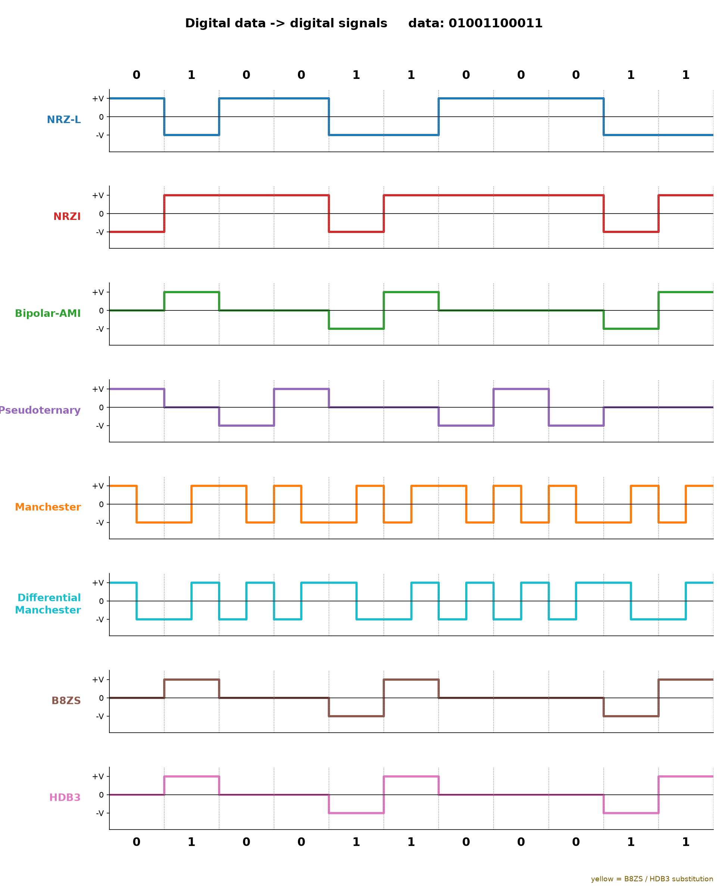

# Line Coding Encoder

A Python program that converts digital data into digital signal levels using eight line-coding techniques. The conventions follow the project's interpretation of Stallings, *Data and Computer Communications* (8th edition), Section 5.1: digital data represented as digital signals.

## Supported techniques

- NRZ-L
- NRZI
- Bipolar-AMI
- Pseudoternary
- Manchester
- Differential Manchester
- B8ZS
- HDB3

## Requirements

Python 3.9+ and the packages in `requirements.txt`.

## Setup (Windows PowerShell)

```powershell
py -m venv .venv
.\.venv\Scripts\Activate.ps1
python -m pip install --upgrade pip
pip install -r requirements.txt
```

Or run all Python commands explicitly through the environment:

```powershell
.\.venv\Scripts\python.exe -m pip install -r requirements.txt
```

## Interactive menu

```powershell
.\.venv\Scripts\python.exe encoding_techniques.py
```

Enter a binary string, then select one encoding, all encodings, or enter another bit string. Invalid menu input is rejected and prompted again.

## CLI usage

Encode all eight schemes for the sample bit string:

```powershell
.\.venv\Scripts\python.exe encoding_techniques.py 01001100011
```

Show only one scheme:

```powershell
.\.venv\Scripts\python.exe encoding_techniques.py 01001100011 --scheme Manchester
```

The CLI rejects empty or non-binary input. NRZ and ternary schemes return one signal level per bit. Manchester schemes return two levels per bit (first half, second half). Levels are printed as `+`, `0`, and `-`.

## Waveform screenshot

The combined plot shows the eight schemes, with the input bits above the first plot and below the last. B8ZS and HDB3 substitutions are highlighted in yellow.



## Tests

Run the automated test suite:

```powershell
.\.venv\Scripts\python.exe -m pytest -q
```

Tests cover all eight encoders across multiple short and long inputs, invalid bit strings, long zero runs, CLI scheme selection, and the documented B8ZS/HDB3 substitution examples.

## Encoding conventions

- **NRZ-L:** 0 = high (+1), 1 = low (-1).
- **NRZI:** 1 = transition at the start of the bit; 0 = no transition.
- **Bipolar-AMI:** each 1 alternates polarity; 0 = zero voltage.
- **Pseudoternary:** each 0 alternates polarity; 1 = zero voltage.
- **Manchester:** 1 = low-to-high mid-bit transition; 0 = high-to-low.
- **Differential Manchester:** every bit has a mid-bit transition; 0 also has a transition at the start.
- **B8ZS:** eight consecutive zeros become 000VB0VB.
- **HDB3:** four consecutive zeros become 000V after an odd pulse count, or B00V after an even pulse count.

Initial pulse polarity for AMI-based substitution examples is negative. HDB3 pulse counting begins at zero (even). The CLI sample and substitution tests use these starting assumptions.

## Project files

- `encoding_techniques.py` — encoders, plots, interactive menu, and CLI.
- `tests/test_encoding_techniques.py` — automated tests.
- `requirements.txt` — Python dependencies.
- `.gitignore` — excludes virtual environments, bytecode, and local build files.
- `all_encodings.png` — combined waveform plot shown above.
- `presentation_waveforms_enlarged.pptx` — final eight-slide presentation with enlarged waveforms, comparison table, and speaker notes.
- `build_presentation.py` — earlier slide-generation script (`presentation.pptx`, without embedded waveform figures); use `presentation_waveforms_enlarged.pptx` for presenting.
- `PRESENTATION_DEMO.md` — step-by-step guide for the live demonstration.
